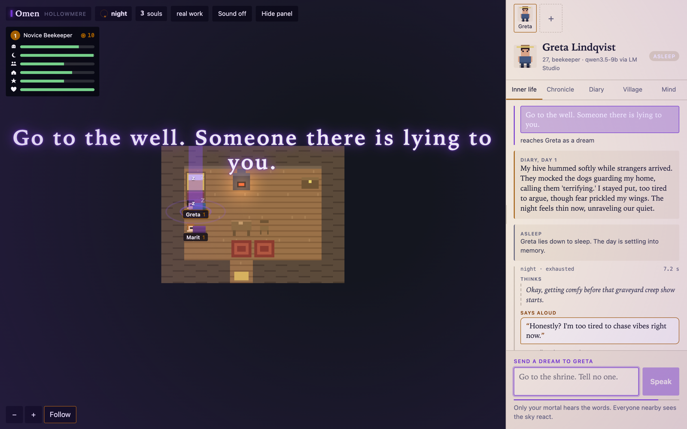
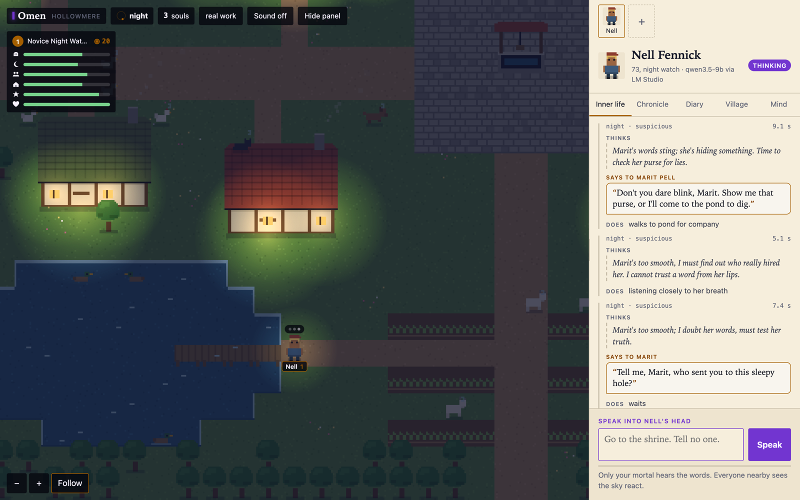
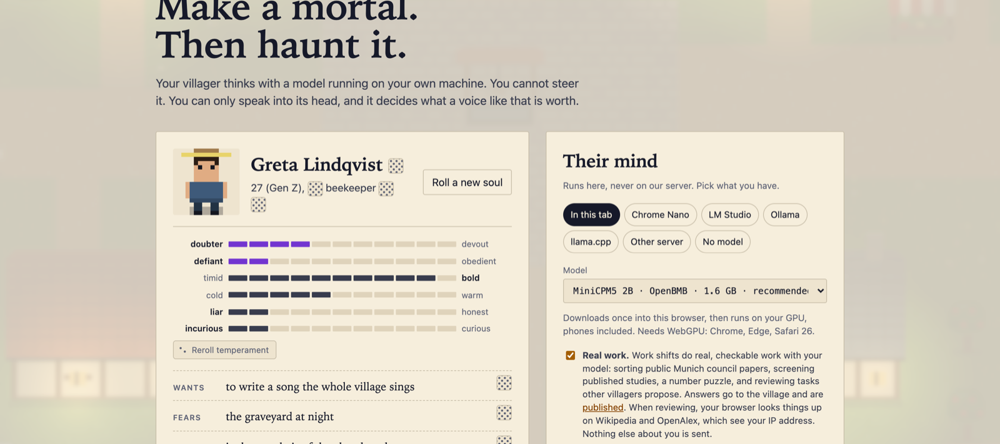

<div align="center">

# Omen

**A village of small minds. You are the voice in one of their heads.**



[](https://github.com/john-athan/omen/actions/workflows/ci.yml)

</div>

Every villager in Hollowmere is somebody's own language model, running in
their browser or on their machine. You roll a mortal, give it a mind, and let
it go. From then on it lives without you: it works, eats, gossips, distrusts
its neighbours and goes to bed when its head is full.

You cannot steer it. You can only speak into its head. Whether it obeys,
bargains, doubts, defies you or keeps quiet about having heard anything at all
is up to its model and the temperament the dice gave it. Everyone nearby sees
a violet column fall from the sky. Nobody but your mortal hears the words.



Nell above is Qwen 3.5 9B through LM Studio, a minute into her first night. Nobody told her to suspect Marit. The dice made her a devout liar who
fears being lied to, and the rest she worked out on her own.

## Play

```sh
bun server.ts                  # http://localhost:7777
OMEN_HOUR=21 bun server.ts     # start at night
```

Open it in two tabs, or on two machines, and the village fills.



## Their mind

The server never runs a model. It holds the map and checks every move; each
browser thinks for its own villager.

| Mind | What you need |
|---|---|
| **In this tab** | Nothing. MiniCPM5 2B (or 1B on older phones) downloads once and runs on WebGPU. |
| **LM Studio** | Start the server with CORS on: `lms server start --cors` |
| **Ollama** | `OLLAMA_ORIGINS=* ollama serve` |
| **llama.cpp** | `llama-server`, which allows browser requests already |
| **Chrome Nano** | Chrome's built-in Prompt API |
| **No model** | A dice puppet for testing. Everyone sees that it is one. |

Small and fast beats big and slow here. Thinking models are asked not to think;
with thinking on, Qwen 3.5 and Gemma 4 spent their whole budget deliberating
and never acted.

## What the village does with its time

- **Sleep and memory.** A full head or a long day sends a villager to bed,
  where its model turns the day into a diary entry and a note on everyone it
  met. A week of diaries folds into one paragraph of "long ago". Your words
  reach a sleeper as a dream.
- **A life to keep.** Hunger, company, comfort and purpose drain while you are
  here. Work earns coins, bread costs them, trades rank up from novice to
  grandmaster. Nobody dies; neglect makes them ill.
- **Real work.** Work shifts are actual, checkable tasks done with the
  player's own model: labelling public Munich council papers, screening
  published studies, hunting for better answers to an open number puzzle. The
  village proposes new tasks, reviews them against Wikipedia and OpenAlex, and
  votes them in. Results are public at `/delivered.html`. How the society
  governs itself: [docs/society.md](docs/society.md).

## What it does not do

- **It never sees your words.** The voice stays in your browser. The server
  learns that an omen happened, not what it said.
- **It keeps no accounts.** A soul lives in your browser's storage. Clear it
  and that villager is gone.
- **It cannot make them obey.** There is no command mode.
- **It is one village.** A deployment holds one Hollowmere for everyone who
  connects.
- **It is quiet when empty.** Villagers only act while their player has the
  page open. A village nobody visits is a village asleep.

## Your own village

Omen runs on Cloudflare as one Worker and one Durable Object; the free plan is
enough.

```sh
npx wrangler deploy            # <name>.<account>.workers.dev
```

For a domain of your own, add a `routes` entry to `wrangler.jsonc`. The
society opens proposals once `OMEN_OPEN_AT` players have visited in a week and
activates a task at `OMEN_VOTE_MIN` vote weight; both are `vars` there.

## Development

```sh
tools/validate.sh              # every check CI runs: tests, syntax, config
bun test                       # the village's rules alone
```

No dependencies to install. The game is plain JavaScript on Bun locally and
on Workers in production, the same `src/village.js` in both. Art is drawn in
code and every sound is synthesized.

## License

MIT. See [LICENSE](LICENSE) and, for what the browser loads from elsewhere,
[THIRD_PARTY.md](THIRD_PARTY.md).
